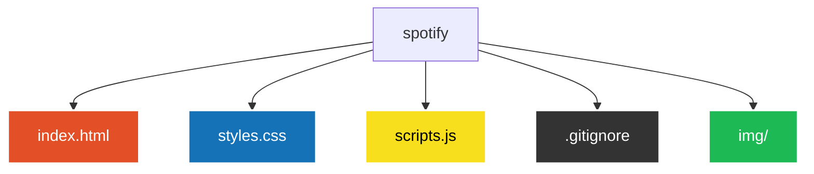

# Spotify Web 🎵🎧


> Uma recriação interativa e moderna da interface do Spotify Web, com busca dinâmica de músicas em tempo real e reprodução de prévias de áudio de 30 segundos via API do iTunes.

> [!NOTE]
> **🚧 Projeto em Desenvolvimento:** Layout atualizado para o design moderno do Spotify (com suporte a *carrossel horizontal no eixo X* para músicas, cards de artistas populares e busca inteligente com *debounce*).

---

## 💻 Sobre o Projeto

O **Spotify Clone** é uma aplicação web desenvolvida para recriar a experiência visual e funcional do player oficial do Spotify. 

A aplicação exibe playlists locais e populares organizadas em listas e carrosséis com rolagem horizontal no eixo X, permitindo pesquisar qualquer música,artista ou trilha sonora dinamicamente. Integra a **API REST do iTunes** para buscar capas em alta resolução (600x600) e prévias de áudio oficiais de 30 segundos com controle de reprodução instantâneo.

---

## ⚙️ Funcionalidades

- **Busca Dinâmica em Tempo Real:** Pesquisa de faixas diretamente na API do iTunes com mecanismo de *debounce* (500ms) para evitar chamadas excessivas durante a digitação.
- **Carrossel Horizontal (Eixo X):** Seção de músicas em fileira única com rolagem lateral suave e responsiva.
- **Player de Áudio Integrado:** Reprodução e pausa de trechos de áudio de 30 segundos ao clicar nos cards.
- **Interface Fiel ao Spotify:** Header superior com busca integrada, sidebar com a seção de biblioteca, tema escuro e cards estilizados.
- **Design Responsivo:** Adaptação completa para desktop, tablets e dispositivos móveis.

---

## 🛠️ Tecnologias Utilizadas

- **HTML5:** Estruturação semântica da barra de navegação, sidebar, grids de conteúdo e banner promocional.
- **CSS3:** Estilização moderna utilizando Flexbox, CSS Grid, variáveis de cores, efeitos de *hover*, suporte a *scroll-x* e consultas de mídia (*media queries*).
- **JavaScript (Vanilla ES6+):** Manipulação dinâmica do DOM, consumo de API assíncrona (`async/await` / `fetch`), codificação de busca (`encodeURIComponent`) e controle do elemento `Audio()`.
- **API do iTunes:** Integração para busca de faixas, metadados e prévias musicais.
- **Iconify:** Biblioteca de ícones vetoriais modernos.

---

## 🌎 Teste meu projeto no seu navegador!

- **Spotify Web:** [VEJA ESTE PROJETO NO SEU NAVEGADOR!](https://alicesilva2012.github.io/spotify/)

---

## 🚀 Como Executar o Projeto Localmente

### Pré-requisitos
- Um navegador web atualizado (Google Chrome, Microsoft Edge, Safari, Firefox, etc.).
- Extensão **Live Server** no VS Code (opcional, mas recomendado).

### ☕ Passo a Passo

1. **Clone o repositório:**
   ```bash
   git clone https://github.com/AliceSilva2012/spotify.git
   ```
2. **Acesse a pasta do projeto:**
   ```bash
   cd spotify
   ```
3. **Execute a aplicação:**
   - Abra o arquivo index.html diretamente no seu navegador OU
   - No VS Code, clique com o botão direito no index.html e selecione **Open with Live Server**.

---

## 📁 Estrutura de Arquivos


